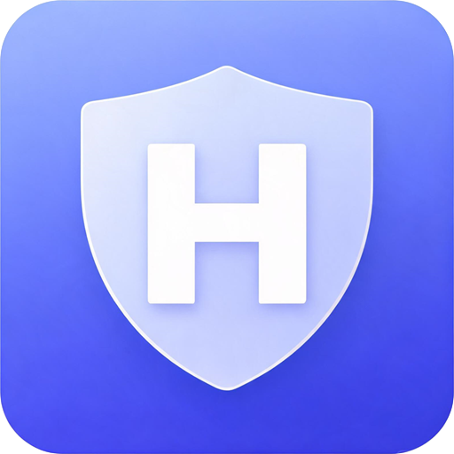
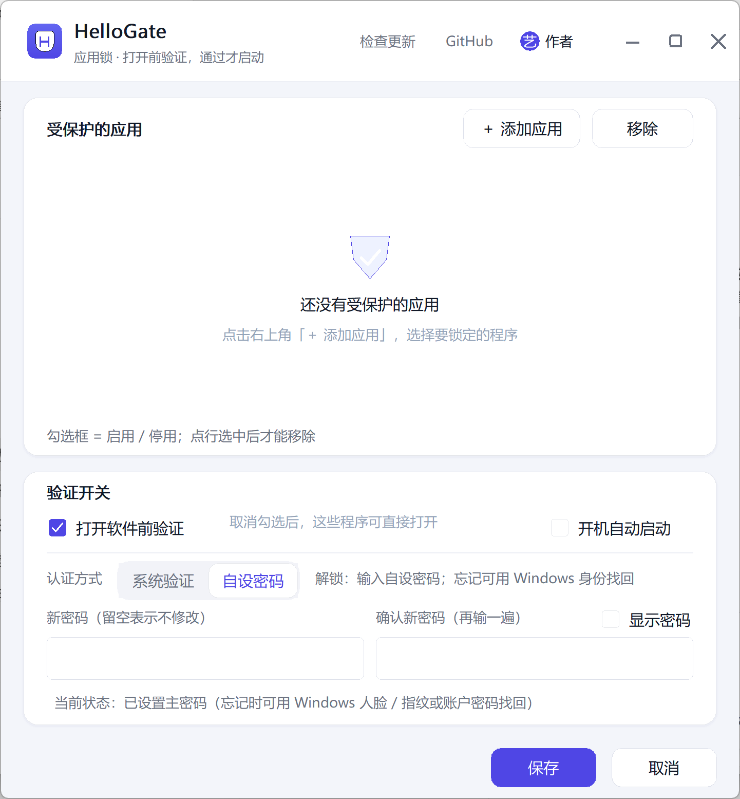

<div align="center">



# HelloGate

**轻量级 Windows 应用锁 · 打开前先验证 · 零杀软误报**

给任何 Windows 程序加一把锁：双击打开时先验证身份，**验证不通过，程序根本不会启动**。
支持 Windows Hello（指纹 / 人脸 / PIN）与自设密码，忘记密码可用 Windows 账户密码找回。

[](LICENSE)
[](#快速开始)
[](https://github.com/yibeigen/hellogate/releases/latest)
[](#核心特性)

</div>

---

## 界面预览

| 首次启动 · 授权激活 | 主控台 |
| :---: | :---: |
|  |  |

## 核心特性

- **启动前拦截**：基于系统官方 IFEO 机制，验证不过程序零运行，不杀进程、不丢数据
- **一键开关**：主控台勾选即可上锁 / 解锁，立即生效
- **认证方式可选**：Windows Hello 或自设密码（任意长度），忘记密码走 Windows 身份找回
- **零杀软误报**：只用 Win32 官方 API，无驱动、无注入、无钩子
- **运行中零打扰**：验证只发生在"打开"那一刻，之后正常使用
- **极致轻量**：单文件约 550 KB，无运行依赖，空闲 CPU 占用为 0
- **检查更新**：主控台内置更新检测，GitHub / Gitee / GitCode 三平台下载

## 授权码获取

首次启动 HelloGate 会弹出激活窗口：

1. 微信关注公众号 **艺杯羹**；
2. 发送消息 **文章**；
3. 收到授权码后填入激活窗口，一次激活、永久生效。

## 快速开始

1. 到 [GitHub Releases](https://github.com/yibeigen/hellogate/releases/latest) 下载 `hellogate.exe`
   （下载慢可改用 [Gitee](https://gitee.com/yibeigen/hellogate) / [GitCode](https://gitcode.com/yibeigen/hellogate) 仓库发行版）；
2. 双击运行，在 UAC 中允许管理员权限（用于登记启动拦截，仅首次）；
3. 输入授权码激活；
4. 主控台点「+ 添加应用」选择要加锁的程序，勾选后保存；
5. 再次打开该程序时，先验证身份才会启动。

从源码编译：

```powershell
git clone https://github.com/yibeigen/hellogate.git
cd hellogate
cargo build --release   # 产物：target/release/hellogate.exe
```

## 仓库镜像

| 平台 | 地址 |
| --- | --- |
| GitHub | <https://github.com/yibeigen/hellogate> |
| Gitee | <https://gitee.com/yibeigen/hellogate> |
| GitCode | <https://gitcode.com/yibeigen/hellogate> |

## 系统要求

- Windows 10 1809+ / Windows 11
- 默认认证为「自设密码」，无需配置 Windows Hello 也能用

## 许可

[MIT License](LICENSE)

---

<div align="center">

**觉得有用？点个 Star 就是最好的支持。**
公众号 **艺杯羹** · 技术文章与软件更新动态

</div>
